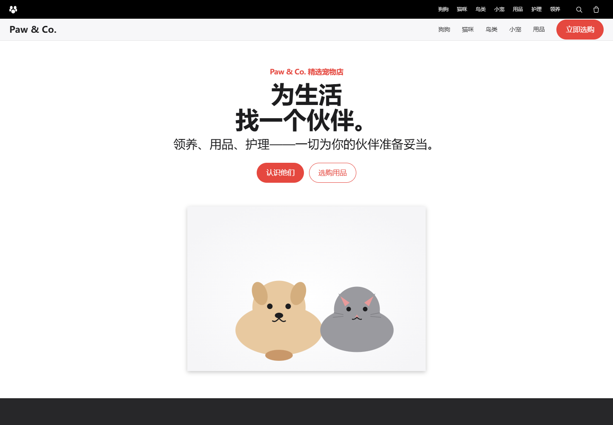

# Paw & Co. 宠物页面：码道内置浏览器精准调整

本项目对应华为 ICT 1.5 练手题，以宠物商店页面为载体，记录元素选中、局部评论和 CSS 双向调整后的结果。页面使用纯 HTML、CSS、JavaScript 和内联 SVG，无第三方运行时或外部图片依赖。



## 元素级调整记录

本项目模拟了 4 条元素评论，未超过码道内置浏览器的 5 条限制：

1. `.btn-primary`：主要行动按钮由蓝色改成珊瑚红 `#e5483f`。
2. `.search__input`：获得焦点时显示 2px 珊瑚红边框和柔和外光。
3. `.card`：悬停时上移 4px、显示阴影和顶部强调线。
4. `.care__item`：左侧增加 3px 珊瑚红边框，强调服务项目。

这些修改都只通过目标选择器完成，没有重排页面结构。

## 页面功能

- 全屏宠物商店首页，包含 Hero、分类、商品、领养和护理区域
- 内联 SVG 宠物与商品插画
- 响应式商品、护理和页脚网格
- 窄屏折叠菜单及 `aria-expanded` 状态
- 搜索框、卡片和按钮的可见焦点/悬停反馈

## 运行与验证

```bash
python -m http.server 8110 --bind 127.0.0.1
python test-ui.py
```

浏览器打开 `http://127.0.0.1:8110`。测试使用 Playwright 和 Microsoft Edge，验证四项元素样式、移动菜单交互、页面脚本错误和外部资源请求。
